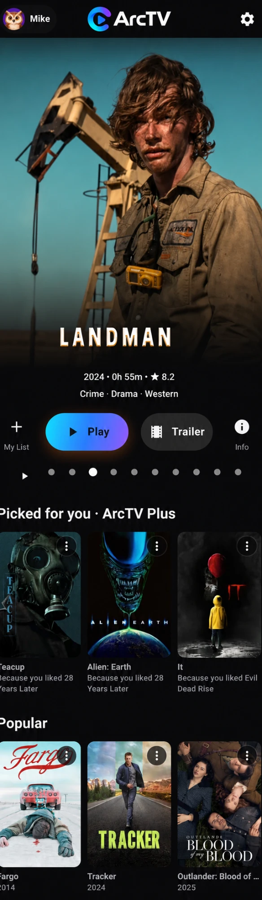

<h1 align="center">Arc TV for Android phones and tablets</h1>

<p align="center"><b>Your streaming, your way, in your pocket.</b><br>
A Netflix-style streaming app for Stremio-protocol addons, built for touch.</p>

<p align="center">
  <a href="https://github.com/MikeC444/ArcTV-MobileAPK/releases/latest"><b>Download the APK</b></a> ·
  <a href="#-installing-on-your-phone-or-tablet">Install it</a> ·
  <a href="https://arctv.org">arctv.org</a>
</p>

<p align="center">
  
</p>

Arc TV is a modern media center for your phone. Content comes from **Stremio addons** rather than a fixed catalog, so you choose the addons you want, the same way Stremio itself works. Arc TV ships with no content of its own.

It is built with Kotlin and Jetpack Compose for Android phones and tablets (Android 6.0 or newer), and works held upright or sideways. Sign in with the same account as the [Fire TV, Firestick and Android TV app](https://github.com/MikeC444/ArcTV-AndroidTV), the [web app](https://web.arctv.org) and the [Mac app](https://github.com/MikeC444/ArcTV-Mac) and everything is already there.

## ✨ Features

- **Addon-powered**: discover movies and series from whichever Stremio-protocol addons you install
- **Made for touch**: tap, swipe and drag your way around, held upright or sideways
- **Sync everywhere**: your My List, Continue Watching, settings and addons follow you between your phone, your TV, the web and your Mac, and back
- **A player that plays more**: VLC's player is the default, so 4K, HEVC and Dolby Vision files that the built-in player can't decode still play. Switch players any time in **Settings → Player**, and each title remembers the one you picked for it
- **Touch controls**: tap the picture for the controls, double-tap the left or right side to skip 10 seconds, drag the bar to seek, with lists for audio, subtitles and playback speed
- **Pick any episode**: an Episodes button in the player, and the next episode starts without leaving it
- **Sources that suit a phone**: the source list opens on 1080p, which plays smoothly on phones, with the best 1080p source recommended first; filter by Stereo, 5.1, 7.1 or Atmos and set your preferred audio language once
- **Torrents inside the app**: play magnet links and `.torrent` files right inside Arc TV with nothing extra to install. Tap a magnet link in any app and choose Arc TV. Torrents ask before using mobile data
- **Browse your way**: Home, Movies, TV Shows, My List and Search, with a detail page for every title and a poster menu with My List, Watched, Like and Not for me
- **Picked for you**: a Home row chosen from the movies and shows you like, finish and save, with the reason under every poster
- **Stays up to date**: the app tells you when a new version is out and what changed (see `RELEASE_NOTES.md`), and installs it for you
- **ArcTV Plus** (optional; the app stays free): up to 5 profiles with kids profiles and PIN locks, Picked for you, Smart source picking and your watch stats

## 📱📺 Arc TV everywhere

Same account, same list, same addons on every device:

| | |
|---|---|
| 📱 **Android phones and tablets** | this repository |
| 📺 **Fire TV / Firestick / Android TV / Google TV** | [ArcTV-AndroidTV](https://github.com/MikeC444/ArcTV-AndroidTV), also home of the account backend (`server/`) |
| 🌐 **Web** | [web.arctv.org](https://web.arctv.org) ([ArcTV-Web](https://github.com/MikeC444/ArcTV-Web)) |
| 💻 **Mac** | [ArcTV-Mac](https://github.com/MikeC444/ArcTV-Mac) |

## 📲 Installing on your phone or tablet

Arc TV isn't on Google Play yet, so you install the APK once yourself. It takes about a minute.

1. On your phone or tablet, open **[the latest release](https://github.com/MikeC444/ArcTV-MobileAPK/releases/latest)** and download **ArcTV-Mobile.apk**
   (direct link: `https://github.com/MikeC444/ArcTV-MobileAPK/releases/latest/download/ArcTV-Mobile.apk`).
2. Open the downloaded file. Android will ask you to allow installing apps from your browser (or from Files): allow it for this one install.
3. Open **Arc TV**, sign in with your Arc TV email and password (or create an account), and your list and addons are there.

After that the app tells you when a new version is out and what changed, and installs it for you (Android asks you to confirm each update).

## ❓ Questions

**Where do the movies and shows come from?** From the Stremio addons you add. Arc TV only plays what an addon provides and does not host or supply any content.

**Is it free?** Yes. Browsing, playing, My List, Continue Watching and addons are free. ArcTV Plus adds extras on top, and paying for it opens Stripe's page in your browser.

**Is Arc TV affiliated with Stremio?** No. Arc TV is an independent app that supports the Stremio addon format, so addons made for Stremio work in it. It is not affiliated with or endorsed by Stremio.

**Why does 4K stutter on my phone?** Many phones play 1080p more smoothly than 4K, so the source list opens on 1080p. You can pick any other quality from the list.

**What's different from the TV app?** It is the Fire TV app's code adapted for touch: touch controls in the player, full-screen with the system bars tucked away, layouts that fit a phone upright and keep their TV proportions sideways, sign in with email and password straight away (no QR code), adding an addon by pasting its address, no interface sounds and no speaker or passthrough settings. It has its own app id (`com.mangotv.app.mobile`), so it never replaces the TV app, and its own update channel (this repository's releases).

## 🛠️ For developers

### Status

Arc TV on the phone is full-featured and actively growing. It shares the **account, authentication and cloud synchronization system** with the Fire TV and web apps; the backend lives in the [Fire TV repository](https://github.com/MikeC444/ArcTV-AndroidTV) (`server/`), where `docs/ARCHITECTURE.md` explains how it works and `docs/DEPLOYMENT.md` covers running your own instance. `CHANGELOG.md` here has the development history of this app.

### How it works

The app is Kotlin and Jetpack Compose, talking to the same small Node/Express/TypeScript backend as the Fire TV app, which keeps your account and library in Postgres. Catalogs and streams come from the addons you install. Playback uses VLC's engine (LibVLC) by default, with Media3/ExoPlayer (HLS and DASH) as the built-in alternative.

### Project structure

```
app/src/main/java/com/mangotv/app/
  data/model/          Content, Genre, Episode, Season, Stream — the shared metadata model
  data/provider/       CatalogProvider interface + ProviderRegistry (Stremio-style addon architecture)
  data/addon/          Stremio addon client/mapper
  data/auth/           Session/device identity, encrypted-at-rest session storage (Tink/Android Keystore)
  data/network/        OkHttp + kotlinx.serialization API clients talking to the backend
  data/sync/           Per-domain cloud sync (settings, watchlist, continue watching, addons), retry queues, account switching
  data/history/        Local Continue Watching cache
  data/player/         Player preferences, last-used source, other-player usage reports
  data/update/         In-app update check against this repository's releases
  ui/theme/            Colors, typography, motion tokens, dimens — the design system
  ui/components/       Reusable primitives: TvFocusSurface, ContentCard, ContentRow, MangoButton, ArcLogo, loading/error states
  ui/mobile/           Phone and tablet layouts: window sizes, navigation shell, Home, Browse grid, Detail
  ui/home/ ui/browse/ ui/detail/ ui/search/ ui/mylist/ ui/sources/ ui/player/  The main app screens
  ui/player/overlay/   In-player menus and cards: audio/subtitle tracks, speed, source info, episodes, choose player
  ui/auth/ ui/profiles/ Sign-in and profile screens
  ui/settings/         Settings, Home Rows, Addons, Account, Player, Audio, Subtitles
  ui/update/           The update pop-up
  navigation/          Jetpack Navigation-Compose routes/nav host
```

### Building

Requires Android Studio (or the command line with an Android SDK installed):

```
./gradlew assembleDebug
```

CI builds a debug APK on every push to `main` and to `claude/**` branches (`.github/workflows/build-apk.yml`), runs the unit tests, and uploads the APK as a workflow artifact, so a build is available for download without needing a local Android SDK.

### Releasing

Push a tag like `v0.2.0` (or run **Build and publish release APK** by hand). It signs the APK and attaches `ArcTV-Mobile.apk` to a GitHub release, with the notes from `RELEASE_NOTES.md` — the same notes the app's update pop-up shows. It needs these **repository secrets** (Settings → Secrets and variables → Actions):

- `API_BASE_URL` — the backend's https address, same as the Fire TV app
- `RELEASE_KEYSTORE_BASE64` — the keystore file, base64
- `RELEASE_KEYSTORE_PASSWORD`, `RELEASE_KEY_ALIAS`, `RELEASE_KEY_PASSWORD`

Using the same keystore as the Fire TV app is fine. This app sends `X-ArcTV-App-Version` and signs in with platform `android_mobile`, so it shows in the developer panel with its version.

The Fire TV app and this one share most code, so a fix made in one usually belongs in the other. `docs/FIRESTICK_PARITY.md` in the web repository tracks what the Fire TV app is missing.

## 🤝 Contributing

Ideas, bug reports and pull requests are welcome. Open an issue to say hi or to tell us what you'd love to see next.
